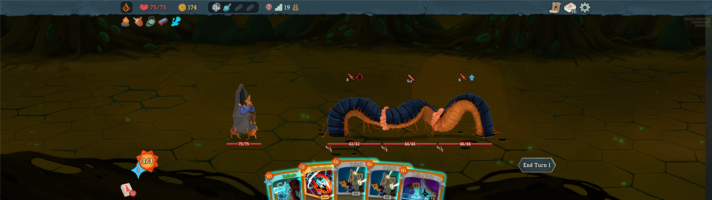

# Slay the Spire 2 — Super Ultrawide 32:9 Support

Slay the Spire 2 supports 21:9 natively and caps there, pillarboxing anything wider, so a
32:9 monitor plays the game on half its screen. This mod lifts that cap and makes the
artwork, the rooms and the HUD behave at 32:9, 48:9 and anything in between.

**At 21:9 and below it does nothing.** Every patch measures the display first and steps
aside inside the range the game already handles, so the native 21:9 experience is left
exactly as Mega Crit shipped it. The one exception is deliberate: the Ancient backgrounds
interpolate only up to 2.333:1 and then stop, which leaves them a little short at 21:9
itself (2.389:1) -- that gap is filled.



## What it does

- **Lifts the 21:9 cap.** The canvas is built at the display's real aspect ratio, so a
  5120x1440 screen renders 5120 pixels wide with no black bars.
- **Covers the screen with artwork.** Backgrounds in combat, shops, rest sites, event and
  Ancient scenes, and the main menu are scaled to fill the wider canvas.
- **Sharpens what it enlarges.** A contrast adaptive pass over the room recovers much
  of the definition bilinear upscaling costs — measured at +58% local detail — without
  touching text, cards or icons.
- **Keeps the HUD readable.** Health, energy, the hand, the piles and the end-turn button
  stay within a 21:9 band in the middle of the screen rather than scattering to the far
  corners — configurable, including off.
- **Leaves your saves alone.** The game normally moves saves to a separate `modded`
  profile as soon as any mod loads. While the only mods present are cosmetic, this keeps
  using your normal save.

Only the `Auto` aspect ratio setting is affected. Pick any explicit ratio in
*Settings → Graphics* and the game behaves exactly as it does unmodded.

## Multiplayer

**Other players do not need this mod.** It declares `affects_gameplay: false`, and the
game's own handshake only compares gameplay-relevant mods between players — a mismatch in
cosmetic ones is logged and allowed. The mod registers no new cards, relics or models, so
the model-ID hash players exchange is untouched.

## Install

1. Make sure *Settings → Graphics → Aspect Ratio* is set to **Auto**.
2. Copy the `ultrawide` folder into `Slay the Spire 2/mods/`, so you end up with:

   ```
   Slay the Spire 2/mods/ultrawide/ultrawide.dll
   Slay the Spire 2/mods/ultrawide/ultrawide.json
   ```

3. Launch the game. It will ask once whether to load mods — accept, then relaunch.

## Configuration

Everything works out of the box. To tune it, create `ultrawide.json` in the game's user
directory — `%APPDATA%\SlayTheSpire2\ultrawide.json` on Windows — and restart the game.
See [`mod/ultrawide.example.json`](mod/ultrawide.example.json).

| Key | Default | What it does |
| --- | --- | --- |
| `background_vertical_anchor` | `1.0` | Where room backgrounds are anchored vertically when they grow. Widening always costs vertical view; `1.0` takes it all out of the sky and keeps the ground. `0.5` centres, `0.0` keeps the sky. |
| `ancient_vertical_anchor` | `0.5` | Same for event and Ancient illustrations. These are single paintings with the subject in the middle, so they are centred rather than anchored low. |
| `background_scale_multiplier` | `1.10` | Overscan. A few per cent of bleed so no room ends up a sliver short at one edge. |
| `hud_max_ratio` | `2.3888888` | Widest aspect the HUD may spread across. `2.3888888` is 21:9. Set to `0` to let the HUD use the whole display. |
| `layer_coverage` | `true` | Grows each background layer individually so none stops short of the edge. A few bosses keep decorative body parts in those layers, and growing the layer carries them further out; set to `false` to leave that art where vanilla puts it. |
| `character_art_zoom` | `0` | Character select is framed at 21:9 rather than stretched; see Known limitations. `1.0` fills the screen instead, at the cost of a third of the character. |
| `sharpness` | `0.6` | Strength of the sharpening pass over the room. Enlarging the background means Godot resamples it bilinearly, which is what makes it look soft; a contrast adaptive pass puts much of that back. `0` turns it off. |

## Building

Requires the [.NET SDK 9](https://dotnet.microsoft.com/download) or newer. The project
references `sts2.dll`, `GodotSharp.dll` and `0Harmony.dll` straight from the game install
and copies none of them.

```sh
cd mod
dotnet build -c Release
```

If the game is not at the default Steam location, pass the path:

```sh
dotnet build -c Release -p:Sts2Dir="D:/Games/Slay the Spire 2"
```

The output is `mod/bin/Release/ultrawide.dll`. Copy it next to `ultrawide.json` in the
game's `mods/ultrawide/` folder.

## How it works

The 21:9 cap is the constant `DisplayVars.maxWideRatio = 2.3888888f`, which the compiler
inlines into every site that uses it — so the constant itself cannot be patched and each
consumer is handled instead. Everything is done with Harmony at runtime; no game file is
modified.

| Patch | What it addresses |
| --- | --- |
| `ContentScalePatch` | Builds the content scale at the display's real ratio instead of clamping to 2580x1080. |
| `BackgroundPatch` | Scales room, shop, rest-site and menu backgrounds to cover the wider canvas. |
| `LayerCoveragePatch` | Grows the individual layers within a background, which are authored at different widths. |
| `AncientBgPatch` | Extrapolates the Ancient background layout past its hand-tuned 21:9 setup. |
| `EventPortraitPatch` | Stretches an event's illustration across the canvas instead of centring it in a void. |
| `EventVfxPatch` | Maps an event's sparkles and its shared dark vignette onto the stretched illustration. |
| `HudClampPatch` | Narrows the combat HUD, the top bar and the map controls to a comfortable width. |
| `BackButtonPatch`, `ConfirmButtonPatch` | Re-place the two buttons that measure from a screen edge, including where they hide. |
| `ViewportRatioPatch` | Re-bases the buttons that position themselves as a fraction of the viewport. |
| `MenuClampPatch` | Narrows the menu screens that put one column against each edge of the canvas. |
| `ModalBackstopPatch`, `BackstopSweepPatch` | Keep every dimmed backdrop covering the display rather than the narrowed band. |
| `SharpenPatch` | Contrast adaptive sharpening over the room, to recover definition lost to enlarging the art. |
| `SavePathPatch` | Keeps the vanilla save directory while only cosmetic mods are loaded. |

Each patch is applied on its own and skipped if it no longer matches the build you are
running, so a change in one part of the game disables that patch rather than the mod.

## Compatibility

Developed against **v0.113.1** (beta branch) and declares a floor of `0.100.0`, so it also
loads on the stable branch, which is a few builds behind. Slay the Spire 2 is in Early
Access and its internals move; if a future build changes one of the methods above, that
patch logs a warning and switches itself off while the rest keeps working. Check the log at
`%APPDATA%\SlayTheSpire2\logs\godot.log` for lines tagged `[Ultrawide]` -- it reports how
many patch groups applied and names any that were skipped.

## What has been checked at 5120x1440

**Menus** -- main menu, Timeline and the epoch reveal, singleplayer and multiplayer
submenus, character select, daily challenge, blitz, custom mode, profile select,
settings (all four tabs, from the menu and mid-run), card library, relic collection,
potion lab, bestiary, character stats, run history.

**In a run** -- map in every act, combat against normal, elite and all twelve bosses,
all four acts, shop room and the merchant's wares, rest site and the forge, treasure
room and its relic, card reward and loot, draw pile and deck views, card inspection,
eight events spot-checked, all eight Ancients, pause, the death and victory screens and
both run summaries.

Re-checked at 16:9 and 21:9, where the mod is inert.

### Known limitations

- **Character select is presented at 21:9**, with the rest of the screen masked off.
  Each character's artwork is one illustration drawn as a 21:9 sheet with an edge -- for
  two of them a flat 2561x1201 image, cape and all -- so there is no transform that
  reaches the sides of a 32:9 screen without either cropping or inventing artwork that
  was never drawn. Enlarging one to fill the screen costs a third of its height, and the
  character is what lives in that third. Leaving them alone is no better: the pieces run
  from 2592 to 2937 units wide, so the border changes thickness with every character you
  click. A fixed 21:9 window settles both -- nothing cropped, nothing stretched, and the
  same frame every time, because the edge you see is no longer the artwork's. Set
  `character_art_zoom` to `1.0` if you would rather have the crop.

  The multiplayer lobby shows the same artwork and keeps the game's own layout: it builds
  its scene inside a SubViewport, where the mask lands across the middle of the picture
  instead of at its edges.
- **A few bosses** keep decorative body parts in the background layers, so
  `layer_coverage` carries them further out than vanilla puts them. Set it to `false` to
  leave that art alone, at the cost of a sliver of uncovered canvas on those fights.

## Credits

Built by maximilianopalomeque. Slay the Spire 2 is by Mega Crit. This mod ships no game assets.

## License

[MIT](LICENSE)
